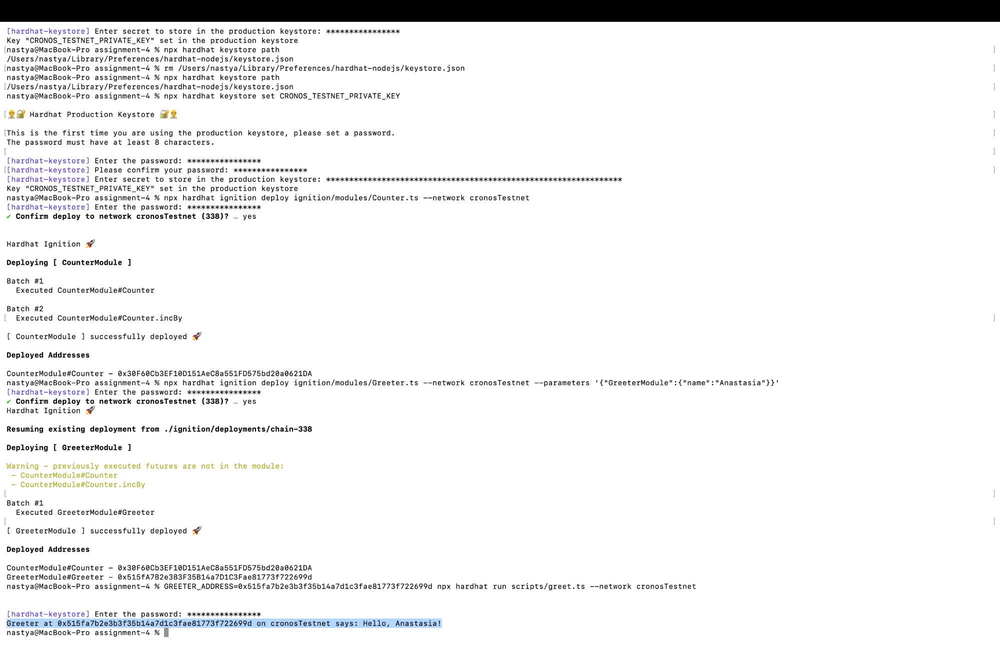

# Assignment 4 — Hardhat 3 and first smart contract

Hardhat 3 project (TypeScript, Mocha + ethers.js) with the sample `Counter` contract and a `Greeter` contract, deployed to my target testnet from Assignment 3: **Cronos Testnet** (Chain ID 338, TCRO) instead of Sepolia.

## Answers

| Task | Contract | Deployment transaction |
|------|----------|------------------------|
| Install Hardhat — sample contract | `Counter` at `0x30F60Cb3EF10D151AeC8a551FD575bd20a0621DA` | <https://explorer.cronos.com/testnet/tx/0x4a0d94919fb7a951fd4beb4f5e08953ddd4c7a44003ad9f5715a5e471693941f> |
| First smart contract | `Greeter` at `0x515fA7B2e3B3F35B14a7D1C3Fae81773f722699d` | <https://explorer.cronos.com/testnet/tx/0xa0eef529d3e450c04848af392c1bc5aceaf4e3c3f9b5cd46499137a96a0ebb5a> |

Calling `greet()` on the deployed `Greeter` returns **`Hello, Anastasia!`**.



## Project layout

| Path | Contents |
|------|----------|
| `contracts/Counter.sol` | Sample contract from the Hardhat template |
| `contracts/Greeter.sol` | Takes a name in the constructor, `greet()` returns `Hello, <name>!` |
| `ignition/modules/` | Ignition deployment modules (`Counter.ts`, `Greeter.ts`) |
| `ignition/deployments/chain-338/` | Ignition deployment record for Cronos Testnet (addresses and journal) |
| `test/Greeter.ts` | Mocha tests for `Greeter` |
| `scripts/greet.ts` | Calls `greet()` on a deployed `Greeter` |

## Greeter contract

```solidity
// SPDX-License-Identifier: MIT
pragma solidity ^0.8.24;

contract Greeter {
    string private greeting;

    constructor(string memory _name) {
        greeting = string.concat("Hello, ", _name, "!");
    }

    function greet() public view returns (string memory) {
        return greeting;
    }
}
```

## Setup and tests

Requires Node.js 22+.

```shell
npm install
npx hardhat build
npx hardhat test
```

Result: `7 passing (3 solidity, 4 mocha)`.

## Network configuration

`hardhat.config.ts` has a `cronosTestnet` network that uses the official Cronos RPC. The private key is stored in Hardhat's encrypted keystore, not in a file:

```ts
cronosTestnet: {
  type: "http",
  chainType: "l1",
  url: "https://evm-t3.cronos.org",
  chainId: 338,
  accounts: [configVariable("CRONOS_TESTNET_PRIVATE_KEY")],
},
```

```shell
npx hardhat keystore set CRONOS_TESTNET_PRIVATE_KEY
```

## Deployment

```shell
npx hardhat ignition deploy ignition/modules/Counter.ts --network cronosTestnet
npx hardhat ignition deploy ignition/modules/Greeter.ts --network cronosTestnet --parameters '{"GreeterModule":{"name":"Anastasia"}}'
```

The `Counter` module also calls `incBy(5)` after deployment; reading `x()` from the deployed contract returns `5`.

## Interaction

```shell
GREETER_ADDRESS=0x515fa7b2e3b3f35b14a7d1c3fae81773f722699d npx hardhat run scripts/greet.ts --network cronosTestnet
```

Output:

```
Greeter at 0x515fa7b2e3b3f35b14a7d1c3fae81773f722699d on cronosTestnet says: Hello, Anastasia!
```
